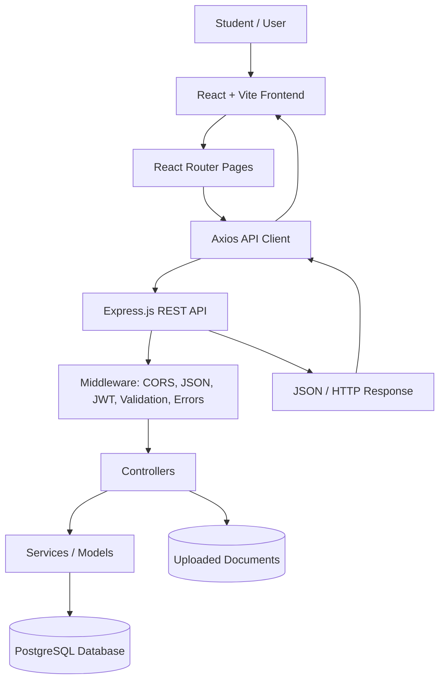
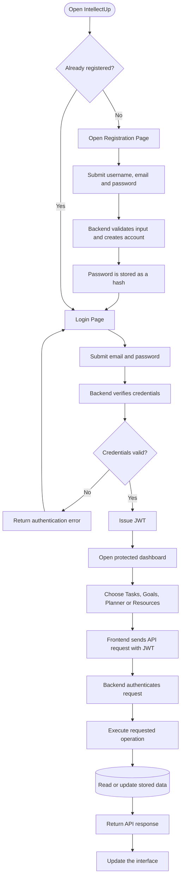

# IntellectUp

<p align="center">
  <strong>A Student Productivity and Academic Management Platform</strong><br />
  Organise academic work, plan study time, manage learning resources, and track progress in one place.
</p>

<p align="center">
  
</p>

---

## Project Overview

**IntellectUp** is a web-based student productivity application designed to bring common academic planning activities into a single workspace. Instead of managing assignments, goals, schedules, and study files across separate tools, a student can use IntellectUp to organise these activities through one account.

The project uses a **React** frontend and an **Express.js** backend. The backend exposes REST API endpoints and uses **PostgreSQL** through the `pg` package for database connectivity. Authentication is handled using JSON Web Tokens (JWT), with password hashing provided by `bcryptjs`.

### Main objectives

- Provide account registration and login.
- Give students a dashboard to access their academic workspace.
- Help students create and manage tasks.
- Allow students to define and update study or productivity goals.
- Provide a planner for organising study activities.
- Allow users to upload and manage learning resources and organise them into folders.
- Track a user's login streak through a dedicated API module.

## Team Members

| No. | Team Member | University UID |
|---:|---|---|
| 1 | **Tathagata Laskar** | `24BCS11358` |
| 2 | **Devaansh Singh** | `24BCS10928` |
| 3 | **Sudipta Deb** | `24BCS12294` |

## Technology Stack

| Layer | Technologies |
|---|---|
| Frontend | React 19, Vite, React Router, Axios |
| UI utilities | React Icons, CSS, Tailwind CSS tooling |
| Backend | Node.js, Express 5 |
| Database connectivity | PostgreSQL (`pg`) |
| Authentication | JSON Web Token (`jsonwebtoken`), `bcryptjs` |
| File uploads | Multer |
| Middleware / utilities | CORS, dotenv, request validation, error middleware |

## Features and Modules

### 1. Authentication

- User registration with username, email, and password fields.
- Login using email and password.
- Password hashing in the backend.
- JWT-based authentication for protected API endpoints.
- A protected user endpoint (`/api/auth/me`).

### 2. Dashboard

The dashboard is the central workspace from which users can navigate to the application's productivity and resource modules.

### 3. Task Management

The task module provides API operations to create tasks, retrieve a user's tasks, update task status, and delete tasks. The task page is part of the React application.

### 4. Goals

The goals module provides operations to add, list, update, and delete goals. It is intended to help users define academic or personal productivity targets.

### 5. Study Planner

The planner module provides operations to create planner entries, retrieve entries, and retrieve entries for the current day.

### 6. Learning Resources and Folders

Users can upload learning files, retrieve their resources, rename or delete resources, and create, list, or delete folders. Uploaded documents are served from the backend's `/uploads` path.

### 7. Login Streak

A protected streak endpoint is included to retrieve a user's streak information.

> **Implementation note:** The feature descriptions above reflect the frontend pages and backend route/controller modules present in the submitted source. Actual behaviour depends on a correctly configured PostgreSQL database and runtime environment. The repository should be run and tested in its target environment before treating every workflow as production-verified.

## System Architecture

IntellectUp follows a client–server architecture. The React application sends HTTP requests to the Express API. The API applies authentication and validation middleware where configured, invokes controllers and services, and accesses persistent data through the PostgreSQL connection pool.



## Application Workflow

The following diagram shows the typical user journey represented by the application's authentication and protected-page structure.



## Backend API Structure

The backend is organised into route, controller, middleware, model, and service directories. The API paths below are based on the route registrations in `server/src/server.js` and `server/src/app.js`.

| Module | Base path | Available operations in source |
|---|---|---|
| Authentication | `/api/auth` | `POST /register`, `POST /login`, `GET /me`, `GET /test` |
| Tasks | `/api/tasks` | `POST /`, `GET /`, `PUT /:id/status`, `DELETE /:id` |
| Goals | `/api/goals` | `POST /`, `GET /`, `PUT /:id`, `DELETE /:id` |
| Planner | `/api/planner` | `POST /`, `GET /`, `GET /today` |
| Login streak | `/api/streak` | `GET /` |
| Resources | `/api/resources` | `POST /upload`, `GET /`, `PUT /:id`, `DELETE /:id` |
| Folders | `/api/folders` | `POST /`, `GET /`, `DELETE /:id` |

Protected endpoints require a valid JWT in the `Authorization` header using the Bearer scheme.

## Repository Structure

```text
IntellectUp/
├── client/
│   ├── src/
│   │   ├── api/             # Axios API client
│   │   ├── components/      # Shared UI components
│   │   ├── context/         # Authentication and theme contexts
│   │   ├── layouts/         # Application layout
│   │   ├── pages/           # Login, register, dashboard and feature pages
│   │   ├── routes/          # Application and protected routes
│   │   ├── assets/          # Images and visual assets
│   │   ├── App.jsx
│   │   └── main.jsx
│   └── package.json
│
└── server/
    ├── src/
    │   ├── config/          # PostgreSQL pool and upload configuration
    │   ├── controllers/     # Request handlers
    │   ├── middleware/      # Authentication, validation and error handling
    │   ├── models/          # Data access/model modules
    │   ├── routes/          # REST API routes
    │   ├── services/        # Application services
    │   ├── uploads/         # Uploaded documents
    │   ├── utils/           # Logger and async handler
    │   ├── app.js
    │   └── server.js
    └── package.json
```

## Getting Started

### Prerequisites

Install the following before running the project:

- Node.js and npm
- PostgreSQL
- Git

### 1. Clone the repository

```bash
git clone https://github.com/Devaanshhh/IntellectUp.git
cd IntellectUp
```

### 2. Configure the backend

```bash
cd server
npm install
```

Create a `.env` file inside the `server` directory with values for your local PostgreSQL instance and JWT secret:

```env
PORT=5000
DB_USER=your_postgres_username
DB_HOST=localhost
DB_NAME=intellectup
DB_PASSWORD=your_postgres_password
DB_PORT=5432
JWT_SECRET=replace_with_a_long_random_secret
MAX_FILE_SIZE=10485760
```

Create the PostgreSQL database named `intellectup` (or use the database name configured in `.env`). The submitted source configures a PostgreSQL connection pool but does not include a complete database schema or migration script. The required tables must therefore be created to match the models and queries before all database-backed features can operate.

Start the backend:

```bash
npm run dev
```

The server uses port `5000` by default. The root API health response is available at `http://localhost:5000/`.

### 3. Configure and run the frontend

Open a second terminal:

```bash
cd client
npm install
npm run dev
```

Vite will print the local development URL in the terminal (commonly `http://localhost:5173`). The Axios client in the submitted source currently targets `http://localhost:5000/api`.

### 4. Build the frontend

```bash
npm run build
```

## Security and Configuration Notes

- Keep `.env` files and real credentials out of GitHub.
- Use a strong, private value for `JWT_SECRET`.
- Do not commit uploaded documents or personal student data unless intentionally required.
- Configure production CORS origins, HTTPS, upload limits, and database credentials before deployment.
- The current frontend API client uses a localhost URL; update it for the deployment environment before hosting the application.

## Current Scope and Further Improvements

The submitted code provides a foundation for a student productivity platform. The following are useful next steps before a production release:

- Add and maintain PostgreSQL schema migrations and seed data.
- Add automated unit, integration, and end-to-end tests.
- Validate ownership and access rules for every user-specific database operation.
- Add pagination, filtering, and search for large task and resource collections.
- Improve upload validation, file-type restrictions, and storage management.
- Add deployment configuration and environment-specific API URLs.
- Add monitoring, structured audit logs, and API documentation.
- Verify all workflows against a configured database and document test results.

## Academic Project Information

**Subject:** Fullstack 2  
**Institution:** Chandigarh University  
**Faculty:** Mohd. Maaz Ansari  
**Project:** IntellectUp – Student Productivity and Academic Management Platform

---

<p align="center">
  <strong>IntellectUp</strong><br />
  <em>Plan better. Stay organised. Make progress.</em>
</p>
